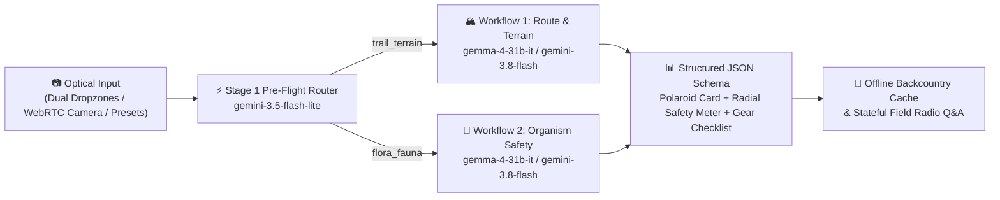

*This is a submission for the [Hacktoberfest Open-Source AI Challenge Week 1: Touch Grass](https://dev.to/challenges/hacktoberfest-week1-2026-10-05)*

## What I Built

Getting outside shouldn't mean staring at a 2,000-word chatbot wall of text while standing at a windy trailhead or crouching next to an unfamiliar wild mushroom. When you're outdoors, **the screen should be the shortest part of the experience**—just enough to verify your gear, check a hazard, respect the ecosystem, and keep moving.

**TrailSense: Touch Grass Safely** is a multimodal outdoor field guide, trail pre-flight safety analyzer, and flora/fauna hazard identification web and mobile app designed with an earthy **"Moss & Granite"** aesthetic (`#1C3F2E` Deep Forest Emerald, `#2D5A43` Hunter Green, `#E3B341` Sunlit Lichen Gold, `#C86D51` Terracotta Amber, and `#F9F8F3` Warm Parchment).

It is built for **day hikers, backpackers, trail runners, dog owners, and amateur naturalists** around two focused field workflows:

1. **🏔️ Workflow 1 — Analyze Route / Trail Ahead (Pre-Flight Check):**
   - Snap or drop a photo of a trailhead sign, alpine talus pass, or unbridged river crossing.
   - TrailSense identifies the **terrain class** (e.g., *Loose Alpine Scree & Wet Glaciated Granite*), flags visible hazards with `HIGH` / `MODERATE` / `LOW` severity pills and tactical mitigations, recommends specific footwear, and generates an **Interactive Essential Gear Checklist**.
   - As you check off items in your pack (trekking poles, microspikes, drybags, offline GPX map), the **Dynamic Radial Safety Meter** (`0–100%` Trail Readiness Score) updates in real time.

2. **🍄 Workflow 2 — Identify Plant / Critter (Bio-Safety & Leave No Trace):**
   - Snap or upload a macro photo of a mushroom, trailside shrub, wildflower, insect, or reptile.
   - TrailSense outputs a tactile **Polaroid-Style Specimen Card** with pinned badges for **Common & Scientific (Binomial) Name**, **Confidence Level** (`High` / `Moderate` / `Low - Requires closer examination`), and a **Safety Verdict** (`SAFE TO TOUCH`, `CAUTION`, `DANGEROUS`, `TOXIC`, `DEADLY`).
   - It pairs a 2–3 sentence natural history & ecological profile with a strict **Leave No Trace & Handling Directive** (e.g., why picking a single *Trillium ovatum* blossom starves its perennial underground rhizome, or how to decontaminate trekking poles and dog fur after brushing *Toxicodendron diversilobum* / Western Poison Oak).

3. **🌤️ Backcountry Quick-Toggles & Zero-Signal Field Kit:**
   - **Floating Weather Sync Pill:** Displays wind speed, UV index, and a live ticking **Sunset Countdown Timer** across trailhead elevations.
   - **Offline-Ready Field Kit (`localStorage` Cache):** Pin any Polaroid route or specimen card before entering a cell dead-zone so your checklists and hazard protocols remain accessible with zero signal.

---

## Demo

🚀 **Live App on Render:** **[TrailSense: Touch Grass Safely — Moss & Granite Field Guide](https://trailsense.onrender.com/)**

### What You Can Try Live Right Now:
- **One-Click Optical Presets (Zero Setup Required):** Click **🟡 Alpine Scree Couloir** or **🔴 Glacial River Ford** in the *Route Ahead* dropzone, or click **🔴 Fly Agaric**, **🔴 Poison Oak**, or **🟢 Trillium** in the *Plant / Critter* dropzone to see procedural field illustrations, Polaroid specimen cards, and hazard breakdowns immediately.
- **Interactive Readiness Gauge:** Check and uncheck pack items in the **Interactive Field Readiness Kit** and watch the SVG radial **Dynamic Safety Meter** recalculate your Trail Readiness Score from Terracotta Amber (`#C86D51`) to Sunlit Gold (`#E3B341`) to Hunter Green (`#2D5A43`).
- **Live Camera & Custom Photos:** Open the live WebRTC **Trail Camera / Macro Camera** (`facingMode: "environment"`) or drop your own outdoor photos to run multimodal inference across **Gemma 4** (`gemma-4-31b-it`, `gemma-4-26b-a4b-it`) and **Gemini 3.8 Flash** (`gemini-3.8-flash`).

---

## Code



🔗 **GitHub Repository:** [https://github.com/sanjana806/Trailsense](https://github.com/sanjana806/Trailsense/tree/main) (MIT Licensed)

---

## How I Built It

TrailSense is built around **open-weight AI models (`gemma-4-31b-it` and `gemma-4-26b-a4b-it`)**, a **two-stage multimodal routing pipeline**, and a **strict JSON Schema contract** powered by the `@google/genai` SDK (`client.interactions.create`).



### 1. Open-Weight Gemma 4 + Two-Stage Multimodal Routing (`src/analyzer.js`)
In the field, latency and battery matter—and so does never giving a false-positive "safe" verdict on a toxic lookalike. Inspired by [Swift's recent DEV benchmark on Flash-Lite routing](https://dev.to/theycallmeswift/i-got-jev-to-zero-mistakes-im-still-using-flash-lite-2mo7) (*"Being overly cautious costs a few cents. Being over confident costs our users' trust... So: when in doubt, defer"*), TrailSense implements a two-stage pipeline:
- **Stage 1 (Sub-Second Modality Triage):** When a hiker snaps a photo in auto-mode, `gemini-3.5-flash-lite` classifies the optical input into `trail_terrain` (Workflow 1) vs. `flora_fauna` (Workflow 2) using `WORKFLOW_ROUTER_SCHEMA`.
- **Stage 2 (Structured Field Assessment with Open-Weight Gemma 4 & Gemini 3.8):** The primary analysis runs on **Gemma 4 31B Dense (`gemma-4-31b-it`)**, **Gemma 4 26B MoE (`gemma-4-26b-a4b-it`)**, or **Gemini 3.8 Flash (`gemini-3.8-flash`)**, enforcing `TRAILSENSE_RESPONSE_SCHEMA` via `response_format`:

```javascript
const interaction = await client.interactions.create({
  model: selectedModel, // "gemma-4-31b-it", "gemma-4-26b-a4b-it", or "gemini-3.8-flash"
  system_instruction: systemPrompt || TRAILSENSE_SYSTEM_PROMPT,
  input: [
    { type: "image", mime_type: mimeType, data: imageBase64 },
    { type: "text", text: `${workflowDirective}${notesDirective}` },
  ],
  response_format: [
    {
      type: "text",
      mime_type: "application/json",
      schema: TRAILSENSE_RESPONSE_SCHEMA,
    },
  ],
});
```

### 2. Tactile "Moss & Granite" Instrument UI (`public/app.js` & `public/styles.css`)
Following [Sylwia Laskowska's principle](https://dev.to/sylwia-lask/what-if-your-ai-agent-never-had-to-leave-the-browser-demo--5g) and [Jana's code-native visual design approach](https://dev.to/janarthanan_soundararajan/why-i-built-a-code-native-visual-studio-for-my-developer-posts-9f0) that AI should power deterministic, tactile UI widgets rather than raw chat walls, the frontend turns the structured JSON output into:
- A **Polaroid Specimen & Route Card** with masking-tape accents and pinned taxonomic/hazard badges.
- An **SVG Radial Safety Meter** whose stroke offset (`stroke-dashoffset`) reacts dynamically as you check off items in your pack.
- **Stateful Field Radio Follow-Ups** that chain `previous_interaction_id` across turns so hikers can ask quick follow-up questions (*"Is this ford safe with a dog at 4 PM?"*).

---

## Why Does Open Innovation Matter?

When you are 12 miles from the nearest paved road in a mountain basin, **closed, black-box AI subscriptions break down in three critical ways** that open innovation solves:

1. **Swappable Open-Weight Models (`gemma-4-31b-it` & `gemma-4-26b-a4b-it`) & Edge Portability:**
   Because TrailSense is architected around open-weight **Gemma 4** models alongside an open JSON Schema contract (`src/prompts.js`) and an open-source MIT codebase, hikers and search-and-rescue clubs aren't locked into a single proprietary cloud vendor. You can run inference via open-weight Gemma 4 endpoints today, or quantize and run Gemma weights locally on a backcountry device or trailhead Raspberry Pi kiosk with zero internet connectivity.
2. **Auditable Safety Guardrails (No Hidden Prompt Drift):**
   In wild mushroom and poisonous plant identification, a silent prompt change in a closed app can be dangerous. TrailSense makes its entire `TRAILSENSE_SYSTEM_PROMPT` and `TRAILSENSE_RESPONSE_SCHEMA` inspectable and editable right inside the UI (`📜 Prompt`). Our safety rule is explicit and verifiable in code: *never state 100% toxicity clearance on wild mushrooms or foraged plants, and always downgrade ambiguous specimens to `[Low - Requires closer examination]` and `[🟡 CAUTION]`.*
3. **Privacy for Backcountry Locations & Rare Species:**
   Rare orchids, slow-growing wildflowers like *Trillium ovatum*, and sensitive wildlife habitats suffer from poaching when coordinates are harvested by closed commercial platforms. An open-source, self-hostable field guide with `localStorage` offline caching keeps your photos, field notes, and trail logs under your own control.

---

## My Agent Session

I built TrailSense pair-programming with **Antigravity (powered by Gemini 3.8 Flash)**, iterating from the core two-workflow field safety system prompt to the full-stack Express + `@google/genai` backend, the **Moss & Granite** UI, GitHub push, and Render deployment:

- **Step 1:** Designed the dual-workflow schema (`trail_terrain` & `flora_fauna`) and implemented the two-stage router + open-weight **Gemma 4** (`gemma-4-31b-it` / `gemma-4-26b-a4b-it`) & **Gemini 3.8 Flash** analyzer in `src/analyzer.js`.
- **Step 2:** Built the **Moss & Granite** UI with topographic SVG contour backdrops, Dual Upload Dropzones, the Polaroid Specimen Card, the live SVG Radial Safety Meter, and Floating Weather/Offline Quick-Toggles.
- **Step 3:** Added offline fallback heuristics so every preset, custom upload, and Field Radio follow-up works out-of-the-box on Render even before a user supplies their own API key.

---

## Prize Categories

- **Best Use of Gemma:** TrailSense integrates Google's open-weight **Gemma 4** models (`gemma-4-31b-it` Dense and `gemma-4-26b-a4b-it` MoE) directly into its multimodal field analysis and stateful Field Radio Q&A pipeline, allowing users to switch seamlessly to open-weight Gemma 4 inference from the header bar.
- **Best Use of Render:** TrailSense is deployed as a live, full-stack Node.js web service on **Render** at **[https://trailsense.onrender.com/](https://trailsense.onrender.com/)**, serving both the zero-build Moss & Granite frontend and the `/api/analyze`, `/api/presets/:id`, and `/api/followup` backend endpoints.
