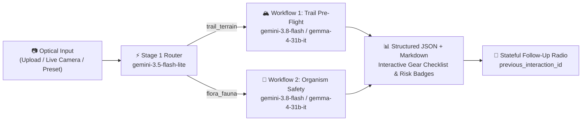

# 🧭 TrailSense AI Field Guide

**Touch Grass Safely & Responsibly** — A multimodal outdoor field guide, trail pre-flight safety analyzer, and flora/fauna hazard identification web application powered by the **Gemini Interactions API** (`@google/genai` >= 2.28.0), **Gemini 3.8 Flash**, **Gemini 3.5 Flash-Lite**, and open-weight **Gemma 4** (`gemma-4-31b-it` / `gemma-4-26b-a4b-it`).

🚀 **Live Demo (Deployed on Render):** **[TrailSense: Touch Grass Safely — Moss & Granite Field Guide](https://trailsense.onrender.com/)**

---

## ✨ Features

1. **Two Specialized Outdoor Workflows**:
   - **🏔️ Workflow 1: Trail & Terrain Pre-Flight Check**
     - Classifies terrain (`Loose Alpine Scree`, `Wet Glaciated Granite`, `Bog/Marsh`, etc.)
     - Detects visible hazards with `HIGH` / `MODERATE` / `LOW` severity badges and tactical mitigations
     - Generates an **Interactive Essential Pack & Footwear Checklist** (persisted in `localStorage` with a live packing progress bar and custom gear additions)
     - Evaluates navigation risk, weather turnaround watchpoints, and cell dead-zone protocols
   - **🍄 Workflow 2: Flora & Fauna Identification & Safety**
     - Identifies Common Name + *Scientific (Binomial) Name* + Organism Group
     - Assigns Confidence Level (`High`, `Moderate`, `Low - Requires closer examination`) and Safety Verdict (`SAFE TO TOUCH`, `CAUTION`, `DANGEROUS`, `TOXIC`, `DEADLY`)
     - Details toxicity/aggression profiles, diagnostic visual marks, ecological role, and **Leave No Trace** handling directives
     - Enforces a strict wild-foraging safety disclaimer

2. **Two-Stage Multimodal Architecture**:
   - **Pre-Flight Router (`gemini-3.5-flash-lite`)**: Sub-second classification of uploaded or camera-captured photos into Workflow 1 (`trail_terrain`) vs. Workflow 2 (`flora_fauna`).
   - **Deep Field Analysis (`gemini-3.8-flash` or open-weight `gemma-4-31b-it`)**: Uses the Gemini Interactions API (`client.interactions.create`) with structured JSON Schema (`response_format`) to populate both interactive UI cards and a clean Markdown field report.
   - **Stateful Field Radio Follow-Ups**: Uses `previous_interaction_id` on `client.interactions.create()` so hikers can ask multi-turn follow-up questions about their trail or specimen.

3. **Field-Ready Web Interface**:
   - Drag-and-drop photo upload + **Live WebRTC Field Camera Viewfinder** (`facingMode: "environment"`)
   - **4 Built-In Field Simulation Presets** (*Alpine Scree & Granite*, *Fly Agaric Mushroom*, *Western Poison Oak*, *Pacific Trillium*) that render procedural optical feeds and work offline out-of-the-box
   - **Offline Backcountry Logbook** (`localStorage`) for saving field reports prior to entering cell dead-zones

---

## 🏗️ System Architecture



---

## 🚀 Quick Start

```bash
# 1. Install dependencies
npm install

# 2. Set your Gemini API key (optional if entering via the UI header or using presets)
$env:GEMINI_API_KEY="your_api_key_here"

# 3. Start the server
npm start
```

Open **http://localhost:3456** in your browser.

---

## 📄 License

Released under the [MIT License](./LICENSE).
